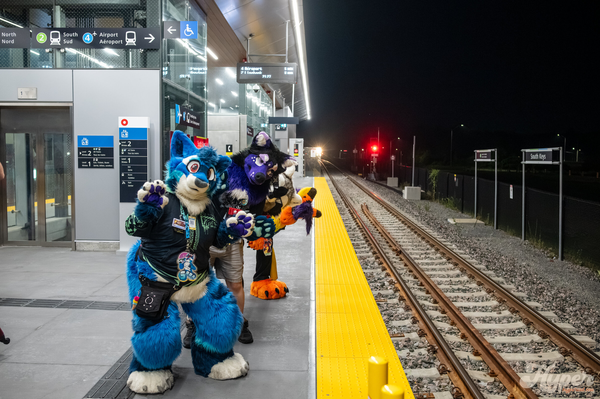

This is where the story goes. Write it just like a blog post: plain paragraphs, **bold**, lists, links, headings, whatever you like.

## Adding a new adventure

1. Make a new folder in `src/content/adventures/` — the folder name becomes the URL, e.g. `algonquin-2026` → `/adventures/algonquin-2026`.
2. Put an `index.md` in it (copy this one) and drop your photos next to it.
3. Set `cover` to the photo for the card, and list the rest under `photos`.

You can also drop a photo right into the middle of the story:

Then keep writing after it.
